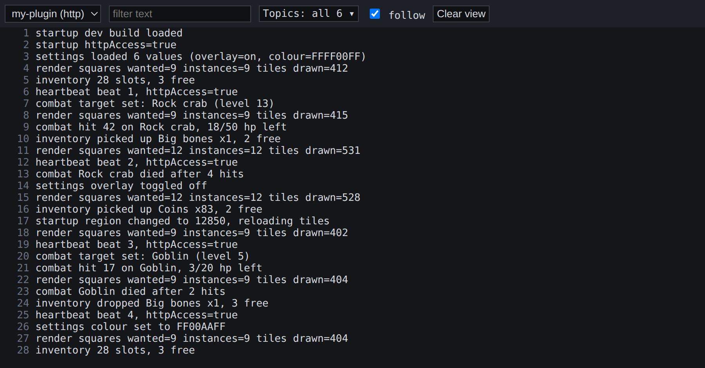
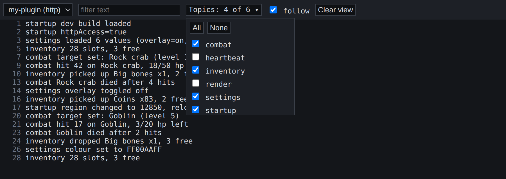

# rs3-devlog

Debug logging for RuneScape (RS3) Client API plugins. In development, each `Log.log(...)` line goes to any of:

- the in-game console,
- PersistentDB,
- a local log server, which shows lines in your browser and writes them to a file.

In a release, the same calls do nothing.



Works on Windows, macOS and Linux with Python 3.8+.

## How it works

- **`log.lua`** ships with your plugin. It returns the logger from `devlog.lua` if that file is present, and a no-op logger if not.
- **`devlog.lua`** is the logger. Never ship it.
- **`tools/deploy.py`** copies both files into your plugin.
- **`tools/logviewer.py`** is the log server and viewer.

## Getting started

1. If your `RuneScape-BETA` folder isn't in the default place for your OS (or it fails to find it), set `JAGEX_DIR` in `tools/devconfig.py`.

2. With your plugin in `<RuneScape-BETA>/dev_plugins/<folder>/`, run:

   ```bash
   python3 tools/deploy.py <folder> --edit-plugin-json
   ```

   This adds `log.lua` and `devlog.lua`, and adds `httpAccess` and the log server URL to `plugin.json`. Leave out `--edit-plugin-json` if you won't use the log server, or don't want the script editing the file directly. You'll need to add the lines yourself (see plugin/plugin.json) if you omit this flag.

3. Log from your code:

   ```lua
   local Log = require("log")
   Log.log("startup", "loaded with %d tiles", count)
   ```

   `"startup"` is the topic. Topics must be turned on in `devlog.lua`.

4. Start the viewer and open <http://127.0.0.1:8766>:

   ```bash
   # on windows, just python instead of python3
   python3 tools/logviewer.py
   ```

5. In the in-game console, run `prf`, then `prl <folder>`.

6. In the Plugin Hub, turn on `httpAccess` for your plugin.

The console shows `<folder>: log server connected`, and your lines appear in the viewer under `<folder> (http)`.

To try it without your own plugin, copy `plugin/` to `dev_plugins/devlog-example/`, run `prf` and `pon devlog-example`, then continue from step 4.

## Settings

At the top of each plugin's `devlog.lua`:

| Setting | Default | |
|---|---|---|
| `NAME` | folder name | Console prefix and log server name. Set by `deploy.py`. |
| `TO_CONSOLE` | `true` | Print to the console. |
| `TO_DB` | `true` | Keep the last 2000 lines in PersistentDB. |
| `TO_SERVER` | `true` | Send to the log server. |
| `TOPICS` | `startup`, `heartbeat` | Topics that log. Others are dropped. |

Log server status messages always print.

## Reading the logs

The viewer's dropdown lists:

- **`<plugin name> (db)`**: PersistentDB lines, under the `"name"` in `plugin.json`.
- **`<folder> (http)`**: lines received by the server since it started.

The **Topics** menu shows or hides lines by topic, and the text box filters by content.



The server also writes every line to `logs/plugin.log`. At 25 MB it moves to `logs/plugin.log.1`, replacing the old one.

## Releasing

- Leave `devlog.lua` out of the zip.
- Remove `httpAccess` and `urls` from `plugin.json` unless your plugin uses them.

If your build replaces the plugin folder in `dev_plugins/`, run `deploy.py` again afterwards, or keep both files in your repo.

## deploy.py

```bash
python3 tools/deploy.py <folder>... [options]
```

```bash
python3 tools/deploy.py --all [options]
```

By default it only adds missing files, and prints every file it skips.

- `--all`: every plugin in `dev_plugins/`, except folders named only by digits.
- `--include-downloaded`: with `--all`, also the numbered folders (plugins downloaded from mod.io).
- `--upgrade`: replace existing `log.lua` and `devlog.lua` files that start with the `-- rs3-devlog managed file` marker. This resets that plugin's settings.
- `--edit-plugin-json`: add `httpAccess` and the log server URL to `plugin.json`.
- `--dry-run`: print what would happen, without writing anything.

## Troubleshooting

If `TO_SERVER` is on but lines can't be sent, the console says why:

- **`URL missing from plugin.json`:** run `deploy.py <folder> --edit-plugin-json`, then `prf`.
- **`needs httpAccess`:** turn it on in the Plugin Hub.
- **`unreachable`:** start `tools/logviewer.py`.
- **`error: ...`:** the client refused the request, for the reason given.

The console command `ppe` doesn't grant permissions (as of 2026-10-22). Use the Plugin Hub.

## PersistentDB rotation

Line *n* is stored as `log:%06d`, and the line 2000 before it is deleted. The next line number is kept in `log:next`, so this carries on across reloads.

## Tests

```bash
lua5.4 tests/test_devlog.lua
```

```bash
python3 -m unittest discover tests
```
